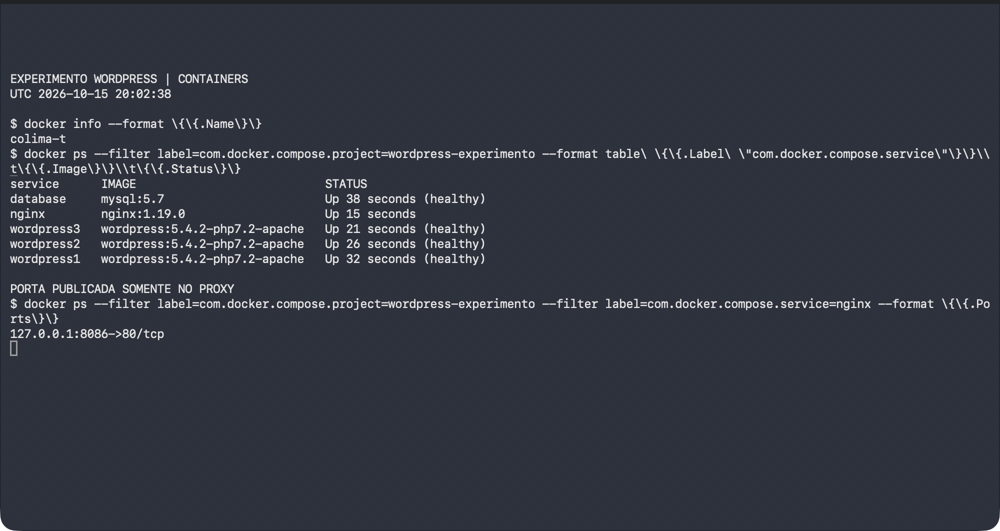
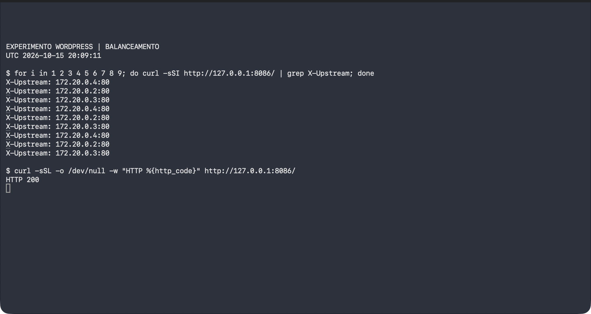
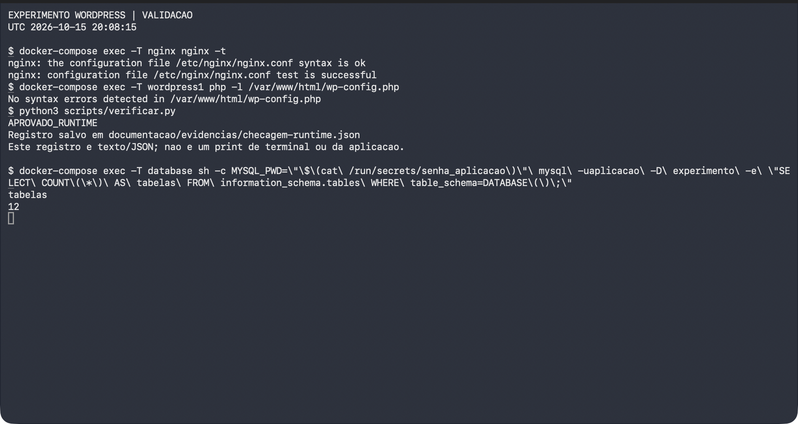
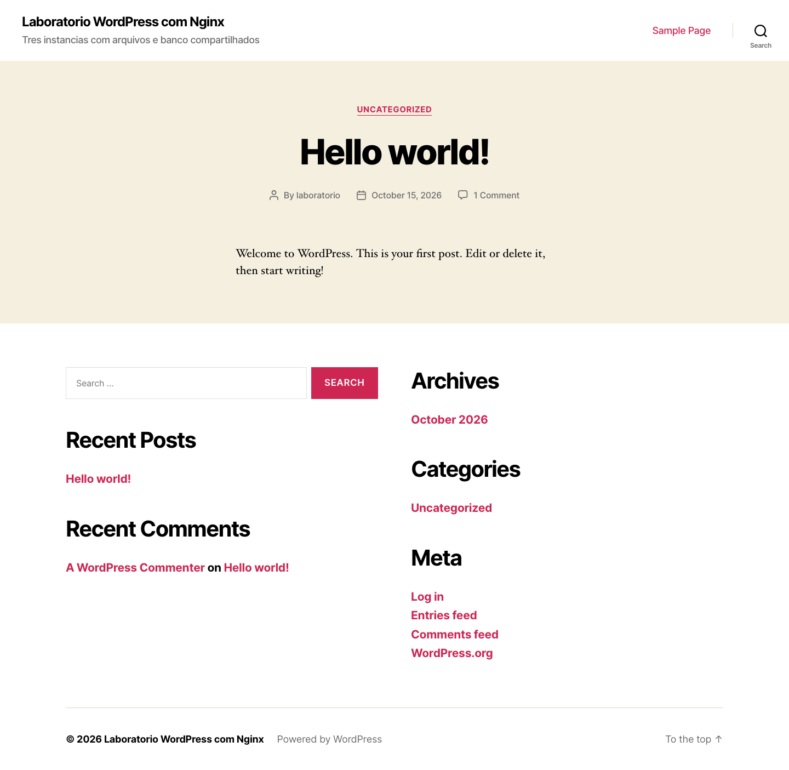
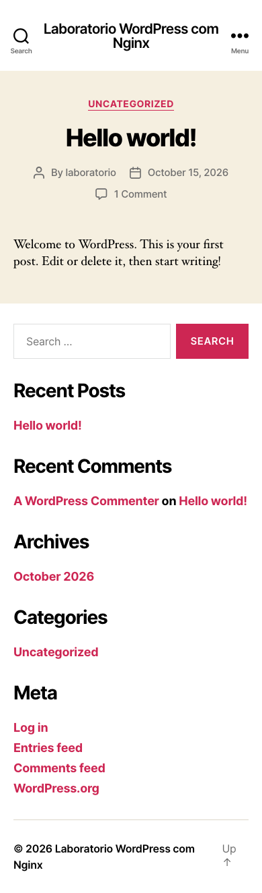

# WordPress com balanceamento de carga em cinco contêineres

Autores: Lucas Kohagura, Pedro Luis e Joao Pedro Lopes.

Data da revisão: 15 de outubro de 2026.

## Objetivo

Preparar um experimento em que Nginx encaminha requisições a três instâncias WordPress que compartilham arquivos e um banco MySQL. A identificação do destino deve ser observável por X-Upstream.

## Requisitos

Exatamente cinco serviços, com mysql:5.7, wordpress:5.4.2-php7.2-apache e nginx:1.19.0. WordPress e MySQL não publicam portas no host. Os três WordPress compartilham /var/www/html e usam o mesmo banco. Nginx monta a mesma pasta em /usr/share/nginx/html.

## Arquitetura

Navegador → 127.0.0.1:8086 → Nginx → wordpress1, wordpress2 ou wordpress3 → database.

A rede de requisições conecta Nginx e WordPress. A rede interna de persistência conecta WordPress e MySQL. Os diretórios html e data/mysql são bind mounts que podem ficar no SSD. Senhas e semente de sessão são arquivos locais separados, entregues somente aos serviços que precisam deles.

## Implementação

O arquivo Compose declara cinco serviços explicitamente. Os WordPress iniciam em sequência após a prontidão das dependências. O script de inicialização copia a distribuição da imagem para a pasta de arquivos compartilhados. A configuração PHP é montada somente para leitura e lê segredos de arquivos em /run/secrets; não é necessário editar PHP com sed no SSD.

O Nginx utiliza um arquivo em conf.d, preservando a configuração principal da imagem oficial. O pool contém os três WordPress. São configurados conexões persistentes, tempos limite e o cabeçalho X-Upstream. O endpoint /saude-proxy verifica somente o proxy e não comprova comunicação com WordPress ou banco.

MySQL 5.7 utiliza linux/amd64 em Apple Silicon, com limites de memória e conexões para um laboratório pequeno. A URL de WordPress é definida por SITE_URL. Cron e atualizações automáticas ficam desabilitados nesta instância para manter as versões e o comportamento do experimento.

## Verificações realizadas

- Compose resolvido sem erro, com exatamente cinco serviços e as tags exigidas.
- Uma única publicação de porta: 127.0.0.1:8086, no Nginx.
- Ausência de publicação de portas no banco e nos WordPress.
- Rede de persistência interna e Nginx fora dessa rede.
- Senha root do MySQL não entregue aos serviços WordPress.
- Nenhum serviço configurado como privileged.
- Sintaxe shell aprovada; preparador reexecutado sem substituir segredos existentes.

## Resultados da execução

Em 15/10/2026, os cinco serviços foram executados no perfil Docker dedicado. MySQL e os três WordPress ficaram saudáveis; Nginx respondeu pela única porta publicada, 127.0.0.1:8086. A validação nginx -t e a análise php -l foram concluídas sem erro.

O WordPress foi instalado em banco próprio, com conteúdo inicial de demonstração e usuário fictício. A consulta confirmou 12 tabelas no banco experimento. Nove requisições retornaram HTTP 200, com três destinos: 172.20.0.2:80, 172.20.0.3:80 e 172.20.0.4:80. O SHA-256 do HTML foi igual nas nove respostas. Os IPs são internos e podem mudar em outra execução.

O projeto foi parado com docker-compose stop e retomado com docker-compose up -d. Após a retomada, o verificador voltou a registrar APROVADO_RUNTIME, com acesso ao banco e à página instalada. O log de persistência e o registro de runtime estão anexados na pasta de evidências. Não foi executado teste de carga.

## Evidências

As figuras são capturas reais desta execução: três capturas de Terminal e a página instalada em navegador Chromium com perfil isolado. As capturas do Terminal excluem a barra de título com identificadores pessoais. Nenhuma imagem foi gerada a partir de logs. O registro navegador-http.json documenta nove respostas HTTP observadas no navegador.

## Conclusão

O experimento foi validado localmente: Nginx distribuiu requisições entre três instâncias WordPress com arquivos e banco compartilhados, mantendo o conteúdo após parar e retomar. Os registros e capturas permitem conferir os resultados apresentados. As versões foram preservadas para a atividade e o teste não caracteriza dimensionamento para uso público.

Código, dados, credenciais e evidências permanecem no SSD dedicado. O pacote público contém código e provas revisadas, sem credenciais, banco ou discos virtuais. Executáveis e componentes de integração do macOS continuam no disco interno.

## Referências técnicas oficiais

Docker Compose: https://docs.docker.com/reference/compose-file/services/

Secrets Compose: https://docs.docker.com/reference/compose-file/secrets/

WordPress: https://developer.wordpress.org/advanced-administration/wordpress/wp-config/

Nginx upstream: https://nginx.org/en/docs/http/ngx_http_upstream_module.html

Nginx proxy: https://nginx.org/en/docs/http/ngx_http_proxy_module.html

As imagens e distribuições mantêm seus avisos de licença e autoria. O projeto não reivindica autoria dessas dependências.
